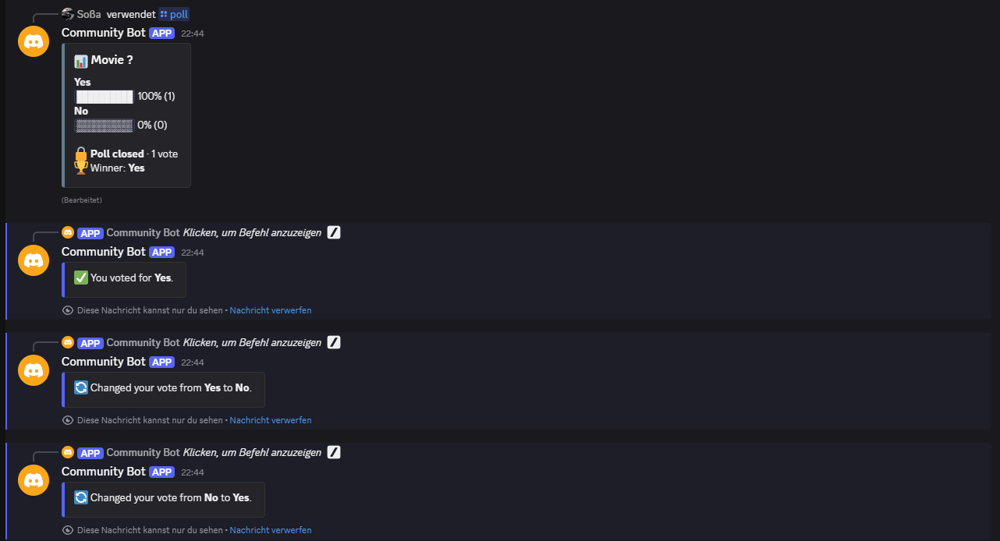
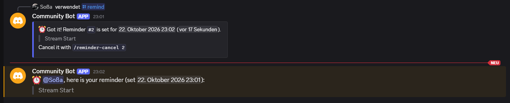
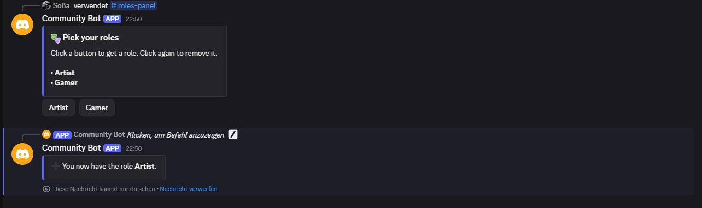
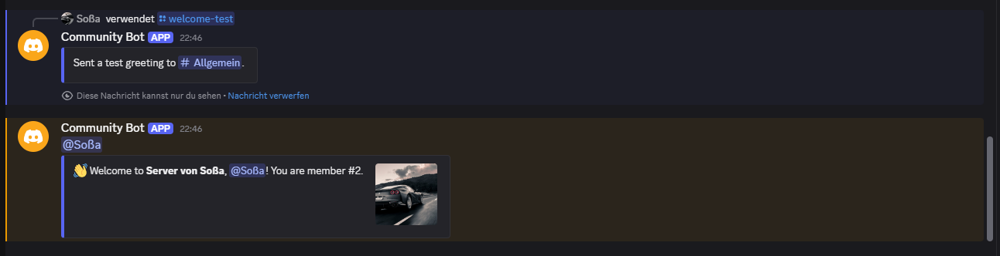
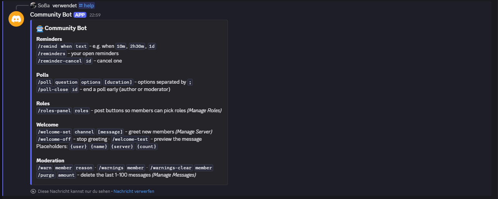

# Discord Community Bot

A Discord bot for community servers with slash commands: reminders, polls
with buttons, self-assignable roles, welcome messages and light
moderation. Built with `discord.py` and SQLite, with 134 tests that run
without internet or a real bot token.



## The problem

Small Discord communities (gaming groups, study servers, clubs, creators)
keep asking for the same handful of things: "remind me later", "let's vote
on it", "let people pick their own roles", "greet new members", "keep a
record of warnings". Big all-in-one bots do this, but they come with
dashboards, paywalls and features nobody needs. This bot covers exactly
these jobs, is easy to read and easy to extend for a specific server.

## Features

- **Slash commands** with descriptions and parameter hints, shown in
  Discord's `/` menu. Admin commands are hidden from normal members.
- **Reminders**: `/remind 2h30m Stream starts` replies with a timestamp in
  every member's own time zone, delivers in the channel (or by DM if the
  channel is gone), and survives restarts of the bot.
- **Polls with buttons**: 2 to 10 options, one vote per person, change or
  take back your vote, live progress bars, optional auto-close with winner.
- **Self roles**: `/roles-panel` posts buttons that give or remove a role.
  Roles with moderator or admin rights are refused on purpose.
- **Welcome messages** in a chosen channel with placeholders
  (`{user}`, `{name}`, `{server}`, `{count}`) and a `/welcome-test` preview.
- **Moderation**: `/warn` (saved, numbered, member gets a DM), `/warnings`,
  `/warnings-clear`, `/purge` 1-100 messages.
- **Buttons keep working after a restart**: each button's ID carries the
  poll or role it belongs to, so old messages stay clickable.
- **SQLite storage**: every server only sees its own data.
- **Safe by default**: user text can never ping `@everyone` or roles,
  errors are only shown to the user who caused them.
- **Configuration via `.env`**, the token is never in the code or the repo.
- **Clean architecture**: the bot logic knows nothing about Discord, so it
  is fully testable and could move to Telegram or Slack with one new file.

| Reminders | Self roles |
| --- | --- |
|  |  |

| Welcome message | All commands (`/help`) |
| --- | --- |
|  |  |

## How it works

```
Discord  <-->  bot.py       thin layer: slash commands, buttons, member join,
                            background loop (due reminders, finished polls)
                 |
               service.py   CommunityService: all rules and reply texts
                 |
               storage.py   SQLite: reminders, polls + votes, warnings,
                            self roles, welcome settings
```

`bot.py` is the only file that imports `discord`. The service gets plain
integers (server, channel, user and role IDs) and returns text, so the
tests call it directly with a fake clock to "travel in time".

## Setup

Requires Python 3.10 or newer.

```bash
git clone https://github.com/Sossa300/discord-community-bot.git
cd discord-community-bot
pip install -r requirements.txt
```

### 1. Create the bot in the Discord Developer Portal

1. Open <https://discord.com/developers/applications> and click
   **New Application**. Give it a name.
2. Go to **Bot**. Under **Privileged Gateway Intents**, turn on
   **Server Members Intent** (needed for welcome messages) and save.
3. Still on **Bot**, click **Reset Token** and copy the token. Treat it
   like a password: whoever has it controls the bot.

### 2. Put the token into `.env`

```bash
cp .env.example .env
```

```ini
DISCORD_BOT_TOKEN=paste-your-token-here
GUILD_ID=123456789012345678
```

`GUILD_ID` is optional: with your test server's ID the slash commands show
up there instantly. (Discord: User Settings > Advanced > Developer Mode,
then right-click your server icon > Copy Server ID.) Leave it empty to
register the commands on every server the bot is in.

`.env` is listed in `.gitignore` and must never be committed. If a token
leaks, click **Reset Token** in the portal, the old one stops working.

### 3. Invite the bot to your server

In the portal go to **OAuth2 > URL Generator**, tick the scopes `bot` and
`applications.commands`, then these bot permissions:

| Permission | Used for |
| --- | --- |
| View Channels, Send Messages, Embed Links | all replies |
| Read Message History | closing polls, `/purge` |
| Manage Roles | self roles |
| Manage Messages | `/purge` |

Open the generated link and choose your server. Or use this link with your
application ID (General Information > Application ID):

```
https://discord.com/oauth2/authorize?client_id=YOUR_APP_ID&scope=bot+applications.commands&permissions=268528640
```

**Role order matters:** Discord only lets a bot give roles that are below
its own role. In Server Settings > Roles, drag the bot's role above the
roles members should be able to pick.

### Configuration

| Variable | Default | Meaning |
| --- | --- | --- |
| `DISCORD_BOT_TOKEN` | (required) | Token from the Developer Portal |
| `GUILD_ID` | (empty) | Test server: commands appear instantly there |
| `DB_PATH` | `data/community.db` | SQLite database file |
| `CHECK_INTERVAL_SECONDS` | `30` | How often reminders and polls are checked (min. 5) |
| `MAX_REMINDERS_PER_USER` | `10` | Open reminders per member and server |
| `LOG_LEVEL` | `INFO` | `DEBUG`, `INFO`, `WARNING` or `ERROR` |

## Usage

```bash
python main.py
```

Stop it with `Ctrl+C`. Then type `/` in your server:

| Command | Who | Example |
| --- | --- | --- |
| `/remind` | everyone | `when: 2h30m` `text: Stream starts` |
| `/reminders`, `/reminder-cancel` | everyone | `/reminder-cancel id: 3` |
| `/poll` | everyone | `question: Movie night?` `options: Friday; Saturday; Sunday` `duration: 1d` |
| `/poll-close` | poll author, moderators | `/poll-close id: 2` |
| `/roles-panel` | Manage Roles | `role1: @Gamer` `role2: @Artist` `title: Pick your hobbies` |
| `/welcome-set`, `/welcome-off`, `/welcome-test` | Manage Server | `channel: #welcome` `message: Hi {user}, read #rules!` |
| `/warn`, `/warnings`, `/warnings-clear` | Moderate Members | `member: @Bob` `reason: Spam` |
| `/purge` | Manage Messages | `amount: 20` |
| `/help` | everyone | overview of all commands |

Durations understand `30s`, `10m`, `2h30m`, `1d`, `1w`, `1 day 4 hours`
and a bare number as minutes.

For 24/7 operation, run `python main.py` on a small VPS or a Raspberry Pi,
for example as a systemd service.

## Adapting it for a client server

| You want to ... | Change |
| --- | --- |
| change texts, limits or rules | `service.py` (`HELP_TEXT`, `MAX_*`, the methods) |
| add a command | a method in `CommunityService` + one `@tree.command` in `bot.py` |
| log warnings to a mod channel | `warn` in `bot.py`, send `reply.text` to that channel |
| use PostgreSQL instead of SQLite | `storage.py` (same method names) |
| build it for Telegram | replace `bot.py`, the rest stays |

## Tests

```bash
python -m pytest
```

134 tests cover configuration, duration parsing, storage, reminders
(including delivery after a restart), polls, self roles, welcome
messages, moderation and the Discord layer itself: command permissions,
button IDs after a restart, replies, role changes, the welcome message and
the background loop. Discord objects are replaced by small fakes, so no
network and no real token are needed.

## Project structure

```
discord-community-bot/
├── main.py                 # entry point: python main.py
├── community_bot/
│   ├── config.py           # settings from .env
│   ├── storage.py          # SQLite tables and queries
│   ├── service.py          # bot logic, platform independent
│   └── bot.py              # slash commands, buttons, background loop
├── tests/                  # pytest suite with fake clock and fake Discord objects
├── docs/                   # screenshots
├── .env.example
└── requirements.txt
```

## Kurzfassung auf Deutsch

Ein Discord-Bot für Community-Server mit Slash-Commands: Erinnerungen
(`/remind`), Umfragen mit Buttons und automatischem Ende (`/poll`),
Rollen per Button (`/roles-panel`), Willkommensnachrichten
(`/welcome-set`) und kleine Moderation (`/warn`, `/warnings`, `/purge`).
Alle Daten liegen in SQLite, Buttons funktionieren auch nach einem
Neustart. Der Token steht nur in `.env`, die nie committet wird. Die
Bot-Logik ist von Discord getrennt und mit 134 Tests ohne Internet
abgedeckt.

## License

[MIT](LICENSE) © 2026 Sossa300
